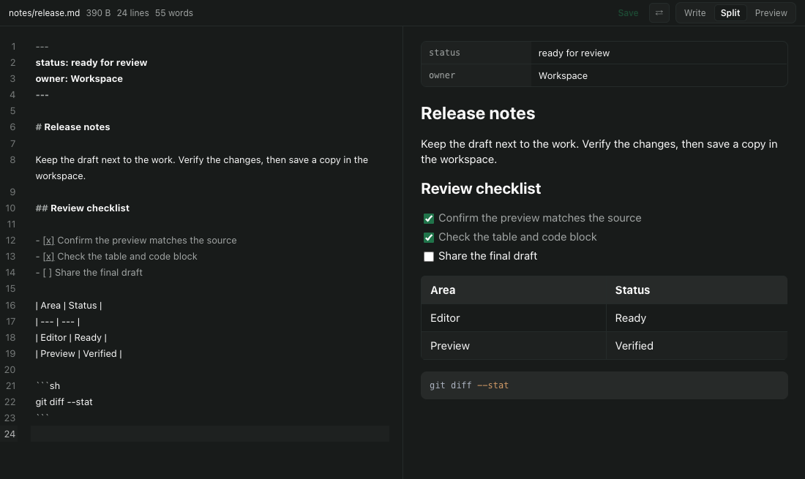

# Paseo-markdown

[简体中文](README.zh-CN.md)

Write Markdown in Paseo with the document rendered beside the source as you type. The preview is
Paseo's own Markdown component, so headings, tables, code blocks, task lists, and links look and
behave exactly like they do in agent messages and the built-in Markdown panel.

Two entry points share the same writing surface:

- **The new-tab menu.** Click **+** and choose **Markdown** for a new Markdown window. It opens an
  **unsaved draft**; no file exists until you save.
- **Any Markdown file tab.** Open a `.md` / `.markdown` file and choose the plugin in **Open with…**.



## Highlights

- **Draft first, file on save.** Opening the Markdown window does not touch the disk. The toolbar
  says **Untitled draft**, and **Save** stays disabled until you type. Saving asks for a path (the
  first free `untitled.md` is suggested) and creates the file with the current text.
- **The first save never overwrites.** File creation is atomic and exclusive; if the chosen path already exists, the
  save is refused and you pick another name.
- **Autosave once it is a file.** After the first save, edits are written 600 ms after the last
  keystroke. A file that changes on disk with unsaved edits becomes an explicit Reload / Overwrite
  choice instead of a silent overwrite.
- **Split, write, or preview.** Split view shows the editor and preview side by side; it becomes
  stacked panes when the tab is narrow. Swap the two panes with one click.
- **Paseo's Markdown engine.** The preview calls `Markdown` from `@getpaseo/plugin/client/ui`, not a
  second renderer, so typography, syntax highlighting, theme colors, and link handling come from
  Paseo itself.
- **A real editor.** CodeMirror on web with Markdown highlighting, line numbers, soft wrap, undo and
  redo, and `Cmd/Ctrl+S`. The new-tab window also edits on iOS and Android with a plain multiline
  editor and the same live preview.
- **Front matter, rendered.** YAML front matter is shown as a key/value table above the document,
  matching the built-in Markdown preview.
- **Bilingual UI.** Labels follow the app language (English and Simplified Chinese).

## Install

Requires Paseo 0.15.3 or later. Enable plugins in Paseo under **Settings → Plugins**.
Install Git and npm on the machine running the daemon, then run:

```sh
paseo plugin add git:Ericwong5021/paseo-live-markdown
```

For a local clone, follow [Development](#development).

## Use

### New Markdown window from the + menu

1. Click **+** and choose **Markdown**. The window opens an empty **Untitled draft**; nothing is
   written to disk.
2. Type. **Save** enables once there is content; `Cmd/Ctrl+S` does the same.
3. **Save** opens a path row. It suggests the first free name (`untitled.md`, `untitled-2.md`, …).
   Type any relative path, such as `notes/2026/plan.md`; parent folders are created as needed.
4. Confirm. The file is created with the text, the toolbar switches to its path, and later edits
   autosave. Choosing an existing path is refused; nothing is overwritten.
5. Closing the tab with unsaved draft text asks first. A dirty draft stays mounted when you switch
   tabs, so coming back keeps the text.

The window reads and writes Markdown files on the selected Paseo host. It accepts workspace-relative
paths only, rejects directory links that lead outside the workspace, and does not open file symlinks.
The plugin has no account, telemetry, or agent-provider integration. Paseo's preview can fetch images
referenced by a document from their external URLs.

### Open an existing Markdown tab

1. Open a `.md` or `.markdown` file in the Explorer.
2. When Paseo asks which panel to use, choose **Markdown** from the `live-markdown` plugin. Check
   **Don't ask me again** to make it the default for the extension on this device.
3. Pick **Write**, **Split**, or **Preview** in the top-right switch. The choice is remembered per tab.
4. Type. Autosave writes 600 ms after the last edit, and the preview follows a frame behind the
   editor so typing stays responsive.

The tab shows the file size, line count, word count (CJK characters count individually), and a dirty
dot while edits are unsaved. **Open with…** in the tab menu switches back to Paseo's built-in Markdown
panel at any time.

## Behavior in detail

| Situation | What happens |
| :--- | :--- |
| Opening the + window | A draft in memory. No read, no write, no create. |
| Typing in a draft | The buffer and preview update; the tab is marked modified. Still no disk write. |
| Save with no path | A path row appears with a free `untitled.md` suggested; confirming creates the file atomically. |
| Save to an existing path | Refused with an error; the draft stays open. |
| Editing an existing file | Autosave 600 ms after the last edit. |
| `Cmd/Ctrl+S` | Draft: opens the path row. Existing file: writes pending edits now. |
| Disk change, no unsaved edits | Reloads and replaces the editor text. |
| Disk change, unsaved edits | Banner offers **Reload** (discard local edits) or **Overwrite**. |
| File deleted | Banner explains the file is gone; edits stay in the tab until it closes. |
| Closing or switching tabs | Dirty tabs prompt on close and stay mounted while you switch. |

File tabs get change notifications from Paseo. The + window polls a cheap `stat` every three seconds,
because workspace panels have no file handle; the same conflict rules apply.

## Limits

- Drafts live in the open tab, not on disk. If the tab is closed and the discard is confirmed, or the
  app restarts, the draft text is gone. Save to keep it.
- The plugin preview renders the Markdown string. Relative image paths are not resolved against the
  file's directory by the plugin API; absolute URLs and remote images work. Use Paseo's built-in
  Markdown panel when a document depends on relative images.
- Very large documents are read and rendered whole. Paseo's built-in panel refuses files above 1 MiB;
  this plugin does not set its own cap, so a multi-megabyte file will open but may feel heavy.
- On iOS and Android the + window edits with a plain text editor (no syntax highlighting); file tabs
  on native show the rendered preview and a read-only source view.

## Development

```sh
git clone https://github.com/Ericwong5021/paseo-live-markdown.git
cd paseo-live-markdown
npm ci --ignore-scripts
npm run typecheck
npm test
paseo plugin add "$PWD"
```

Reload with `paseo plugin reload live-markdown` after editing. `client/web.ts` loads CodeMirror on
web and desktop only. `server/markdown-files.ts` implements filename suggestions, atomic first saves,
and conflict detection. Its tests use temporary directories.

```
live-markdown/
  index.client.tsx        # registers the file panel and the workspace (new-tab) panel
  index.server.ts         # serves the Markdown file RPCs
  client/
    panel.tsx             # file-tab entry
    workspace-panel.tsx   # new-tab draft: save form, path, manual save, then autosave
    document-view.tsx     # toolbar, modes, split layout, banners, native editor
    web.ts                # CodeMirror mount (web only)
    preview.tsx           # Paseo <Markdown> + front matter table
    use-document.ts       # read, debounce, save, watch, conflict handling
    rpc-file.ts           # PluginFile over RPC, including the first-save destination
    document.ts           # front matter and statistics
    format.ts             # byte and date formatting
    messages.ts           # English and Simplified Chinese labels
  server/
    markdown-files.ts     # suggest/read/stat/write/create inside the workspace
  shared/
    markdown.ts           # RPC contracts
    paths.ts              # relative path validation and untitled names
  tests/
```

## License

MIT
