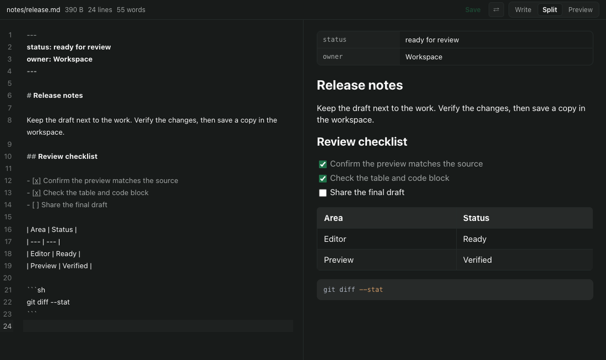

# Paseo-markdown

[English](README.md)

在 Paseo 里书写 Markdown，一边编辑一边看渲染结果。预览直接使用 Paseo 内置的 `Markdown`
组件，标题、表格、代码块、任务列表和链接的样式与行为，都和智能体消息、Paseo 自带的 Markdown
面板完全一致。

插件提供两个入口，共用同一套写作界面：

- **新增标签页菜单。** 点击 **+** 选择 **Markdown**，打开一个新的 Markdown 窗口。它先是一个
  **未保存草稿**，你保存之前不会产生任何文件。
- **任意 Markdown 文件标签页。** 打开 `.md` / `.markdown` 文件，在「打开方式」里选择本插件。



## 特性

- **先草稿，保存才落盘。** 打开 Markdown 窗口不会读写磁盘。工具栏显示 **未命名草稿**，没有内容时
  **保存** 按钮不可用。保存时询问路径（默认建议第一个可用的 `untitled.md`），确认后才会把当前内容
  写成文件。
- **首次保存不覆盖已有文件。** 文件会一次性写入；如果目标路径已存在，会拒绝保存并提示换一个名字。
- **成为文件后自动保存。** 第一次保存后，停止输入 600 ms 自动写盘；磁盘文件在你还有未保存修改时
  发生变化，会明确给出「重新加载 / 覆盖保存」。
- **编辑 / 分栏 / 预览三种视图。** 分栏时编辑器和实时预览并排显示；标签页变窄时自动上下排列，还可以
  一键交换左右或上下分栏。
- **复用 Paseo 的 Markdown 引擎。** 预览调用 `@getpaseo/plugin/client/ui` 的 `Markdown`，不引入
  第二套渲染器，主题配色、排版、代码高亮和链接打开方式都来自 Paseo 本身。
- **真正可用的编辑器。** Web / 桌面端使用 CodeMirror，支持 Markdown 语法高亮、行号、自动换行、
  撤销重做和 `Cmd/Ctrl+S`；+ 菜单窗口在 iOS / Android 上使用原生多行编辑器，并保留实时预览。
- **Front matter 表格。** YAML 头信息会像 Paseo 内置预览一样，渲染成键值表格。
- **中英双语界面。** 文案跟随应用语言切换。

## 安装

需要 Paseo 0.15.3 或更高版本。在 Paseo 的「设置 → 插件」里启用插件功能。运行守护进程的机器需要安装 Git 和 npm。

```sh
paseo plugin add git:Ericwong5021/paseo-live-markdown
```

要从本地源码安装，请参阅[开发](#开发)。

## 使用

### 从 + 菜单新建 Markdown 窗口

1. 点击 **+**，选择 **Markdown**。窗口打开一个空的 **未命名草稿**，磁盘上不会出现文件。
2. 开始输入。有内容后 **保存** 按钮才可用；`Cmd/Ctrl+S` 效果相同。
3. 点 **保存** 会出现路径输入行，默认建议第一个可用名字（`untitled.md`、`untitled-2.md`……）。
   也可以输入 `notes/2026/plan.md` 这样的相对路径，父目录会自动创建。
4. 确认后文件才会以当前内容创建，工具栏切换到该路径，之后的编辑自动保存。选择已存在的路径会被
   拒绝，不会覆盖任何文件。
5. 草稿有未保存内容时关闭标签页会先询问；切换标签页时草稿会保持挂载，回来还能继续写。

插件在所选 Paseo 主机上读写 Markdown。只接受工作区内的相对路径，不允许通过目录符号链接访问工作区外部，也不会打开作为符号链接的文件。插件不需要账号，不收集遥测，不调用智能体服务。Paseo 预览可能从文档中指定的外部网址加载图片。

### 打开已有的 Markdown 标签页

1. 在文件浏览器中打开 `.md` 或 `.markdown` 文件。
2. 当 Paseo 询问使用哪个面板时，选择 `live-markdown` 插件提供的 **Markdown**。勾选「不要再问我」
   即可让该扩展名默认使用此面板。
3. 用右上角的 **编辑 / 分栏 / 预览** 切换视图，选择会按标签页记住。
4. 开始输入。停止输入 600 ms 自动保存；预览会略微延迟一帧跟随，保证输入流畅。

工具栏显示文件大小、行数、字数（中文按字计数），未保存时显示小圆点。标签页菜单里的
**Open with…（打开方式）** 随时可以切回 Paseo 内置的 Markdown 面板。

## 行为细节

| 场景 | 表现 |
| :--- | :--- |
| 打开 + 菜单窗口 | 内存中的草稿。不读取、不写入、不创建文件。 |
| 在草稿中输入 | 缓冲区与预览更新，标签页标记为已修改，但磁盘上仍然没有文件。 |
| 没有路径时保存 | 出现路径输入行，默认建议可用的 `untitled.md`；确认后原子创建文件。 |
| 保存到已存在的路径 | 拒绝并提示，草稿保持打开。 |
| 编辑已有文件 | 停止输入 600 ms 后自动保存。 |
| `Cmd/Ctrl+S` | 草稿：打开路径输入行。已有文件：立即写入待保存内容。 |
| 磁盘文件变化，且没有未保存修改 | 自动重新加载并替换编辑器内容。 |
| 磁盘文件变化，且有未保存修改 | 顶部提示条提供「重新加载」（放弃本地修改）或「覆盖保存」。 |
| 文件被删除 | 提示文件已删除，编辑内容保留到关闭标签页。 |
| 关闭或切换标签页 | 有修改时关闭会先询问；切换标签页时保持挂载。 |

文件标签页由 Paseo 推送磁盘变化；+ 菜单窗口没有文件句柄，因此每 3 秒轮询一次轻量的 `stat`，
冲突规则完全一致。

## 限制

- 草稿只存在于当前标签页，不在磁盘上。确认丢弃后关闭标签页，或应用重启，草稿内容会丢失。需要保留
  请先保存。
- 插件预览渲染的是 Markdown 字符串，插件 API 不会按文件所在目录解析相对图片路径；绝对 URL 和远程
  图片正常显示。文档依赖相对图片时，请使用 Paseo 内置 Markdown 面板。
- 整份文件一次性读入并渲染。Paseo 内置面板会拒绝超过 1 MiB 的文件，本插件没有额外上限，超大文件
  可以打开，但可能比较吃力。
- iOS / Android 上的 + 窗口使用原生纯文本编辑器（没有语法高亮）；文件标签页在移动端显示渲染预览
  和只读源码。

## 开发

```sh
git clone https://github.com/Ericwong5021/paseo-live-markdown.git
cd paseo-live-markdown
npm ci --ignore-scripts
npm run typecheck
npm test
paseo plugin add "$PWD"
```

修改代码后运行 `paseo plugin reload live-markdown`。

只有浏览器和桌面端会通过 `client/web.ts` 加载 CodeMirror。`server/markdown-files.ts` 负责建议文件名、原子创建草稿文件和检测文件冲突。`tests/` 用临时目录验证这些行为。

```
live-markdown/
  index.client.tsx        # 注册文件面板与工作区（新增标签页）面板
  index.server.ts         # 提供 Markdown 文件 RPC
  client/
    panel.tsx             # 文件标签页入口
    workspace-panel.tsx   # + 菜单草稿：保存表单、路径、手动保存，之后自动保存
    document-view.tsx     # 工具栏、视图切换、分栏、冲突提示、原生编辑器
    web.ts                # CodeMirror 挂载（仅 Web）
    preview.tsx           # Paseo <Markdown> + front matter 表格
    use-document.ts       # 读取、防抖、保存、监听、冲突处理
    rpc-file.ts           # RPC 版 PluginFile，含首次保存的目标路径
    document.ts           # front matter 与文档统计
    format.ts             # 字节与日期格式化
    messages.ts           # 中英文文案
  server/
    markdown-files.ts     # 工作区内的文件名建议、读取、状态检查、写入和创建
  shared/
    markdown.ts           # RPC 契约
    paths.ts              # 相对路径校验与未命名文件名
  tests/
```

## 许可证

MIT
